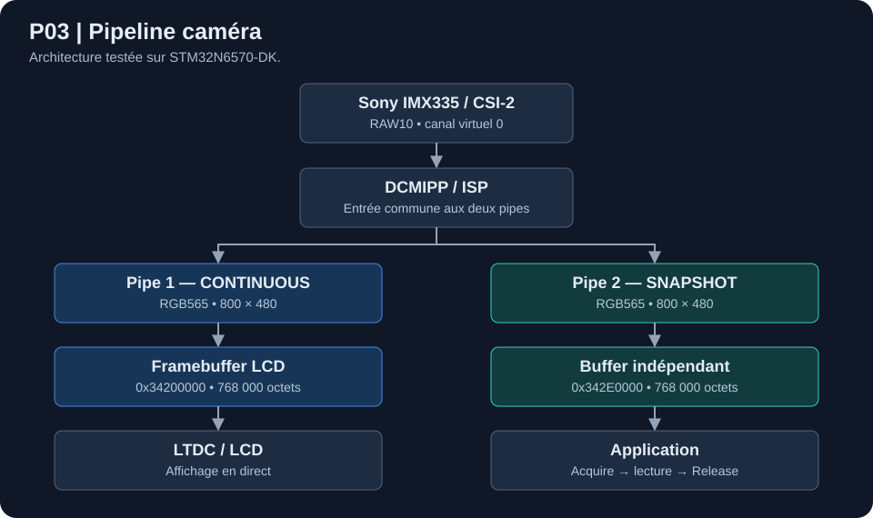
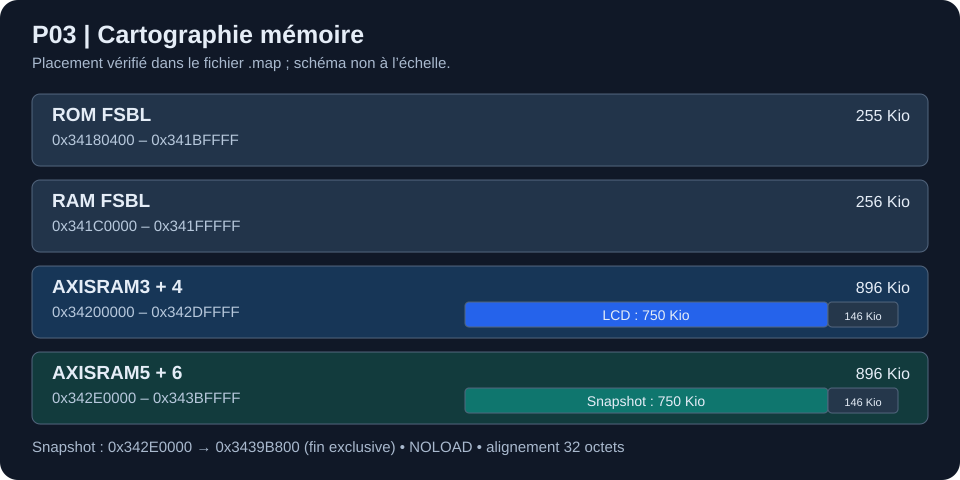
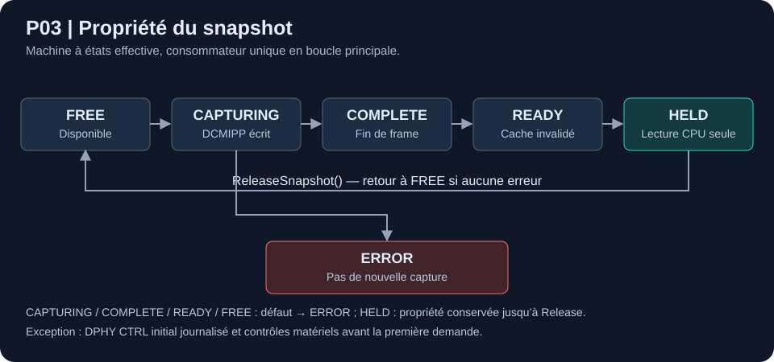
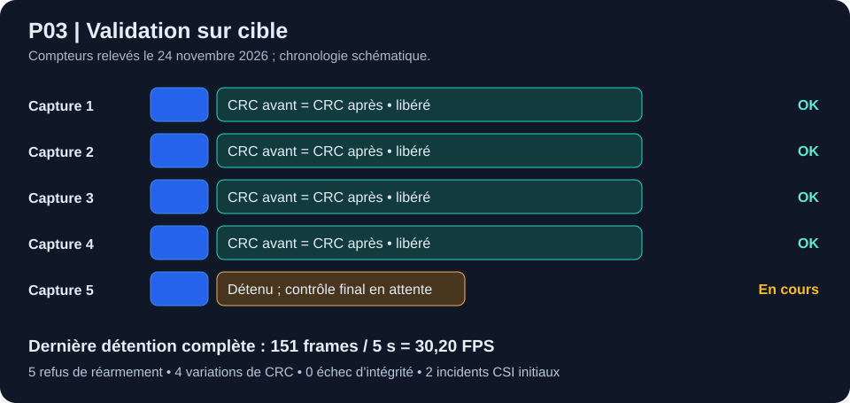

# P03 — Validation STM32 : snapshot et intégrité des buffers

**Date :** 2026-11-24
**Branche :** `Note-de-Seb` (`rahim974/3Dscan2A`)
**Baseline P02 :** `dd25eb349e3d2bf0955646915ffb01155a2d2812`
**Statut :** validée STM32 dans le périmètre expérimental décrit ci-dessous.

## Architecture et propriété

Pipe 1 reste en continu ; Pipe 2 partage l'entrée ISP et réalise des snapshots matériels RGB565 800 × 480. Le callback distingue les pipes. Les identifiants snapshot sont indépendants des identifiants Pipe 1 ; le timestamp est celui de fin de frame (HAL_GetTick), pas de début d'exposition.

Le linker réserve `.camera_snapshot` NOLOAD, 768000 octets, alignés sur 32 octets. Début 0x342E0000, fin exclusive 0x3439B800. Région SNAPSHOT 896 Kio ; marge 149504 octets. AXISRAM5/6 activées dans MSP. Les assertions linker et le contrôle du `.map` ont réussi. Le LCD conserve son adresse 0x34200000. Le binaire de l'implémentation initiale est de 151040 octets ; le buffer NOLOAD n'est pas embarqué comme pixels initialisés dans ce binaire.

API en boucle principale, consommateur unique : RequestSnapshot, IsSnapshotReady, AcquireSnapshot, ReleaseSnapshot, GetSnapshotErrorCount. Les pixels sont en lecture seule par contrat (le type CameraFrame expose encore un pointeur mutable). Le buffer n'est plus utilisable après Release. Clean+invalidate avant DMA, invalidate après fin de capture confirmée, barrières mémoire et contrôle CPTREQ/CPTACT. Timeout 500 ms ; erreur bloquante hors exception initiale documentée. Pas de copie du framebuffer actif.

## Environnement et reproduction

STM32N6570-DK (identifiant individuel non renseigné), Sony IMX335, Windows 11, PowerShell, STM32CubeIDE Debug, STM32CubeN6 v1.2.0. Dépôt D:\Projet_2A ; workspace D:\STM32_Workspace_Projet2A.

1. Compiler Debug, contrôler `.map` et les assertions de la section snapshot.
2. Lancer Debug, reprendre avec F8 ; test automatique dans `main.c` (première demande après 3 s, détention de 5 s, nouvelle demande après libération et délai de 500 ms).
3. Modifier la scène pendant la session : plafond, visage de l'opérateur, mains, puis plafond. LCD affichant les images confirmé par l'opérateur.
4. Suspendre et inspecter `g_snapshot_test`, `s_snapshot_state`, `g_camera_fps`, `hdcmipp.ErrorCode` et les compteurs de démarrage CSI.

CRC32 logiciel sur les 768000 octets, avec invalidation D-Cache avant chaque lecture de référence et de contrôle. Vérification en fin de détention, pas une surveillance continue de chaque octet.

## Compilation et mémoire

Implémentation initiale : build à 15:33:42, 0 erreur, 0 avertissement, 1.217 s ; text 150700, data 324, BSS 778004, total 929028 octets. Ces valeurs précèdent P03-A. P03-A a été chargé et exécuté sur cible (nouveaux symboles observés) ; la console du build P03-A n'a pas été fournie. La clôture revérifie la section du build local courant.

## Premier essai et P03-A

Premier essai : 966 frames Pipe 1 lues, timestamp 32313 ms, 30 FPS, aucun snapshot, SNAPSHOT_ERROR, 2 erreurs, request_tick 0. ErrorCode 32768 (0x8000, HAL_DCMIPP_CSI_ERROR_DPHY_CTRL), Pipe1 BUSY, Pipe2 READY, P2FCTCR 0.

P03-A journalise séparément uniquement les incidents DPHY CTRL avant la première demande lorsque le buffer est FREE, conserve code/tick/lane, efface le bit historique traité et vérifie l'état matériel avant capture ; réactive les interruptions de contrôle DPHY. Garde de 100 ms depuis le dernier incident initial. Les autres erreurs restent bloquantes pour l'acquisition ; un buffer HELD reste détenu jusqu'à sa libération. La cause physique des incidents n'est pas déterminée. Le test ne démontre pas une couverture exhaustive des erreurs CSI ni une récupération après incident en capture.

## Second essai sur STM32

| Indicateur | Valeur observée |
|---|---:|
| Pipe1 frame_id / read_count | 866 / 866 |
| Timestamp Pipe1 | 28989 ms |
| FPS (compteur instantané) | 31 |
| Captures / libérations | 5 / 4 |
| Refus de nouvelle demande pendant HELD | 5 |
| Échecs d'intégrité / erreurs snapshot | 0 / 0 |
| Changements de CRC entre captures | 4 |
| État | SNAPSHOT_HELD |
| Phase test | 2 |
| Dernière latence demande → fin de frame | 49 ms |
| Dernière détention complète | 5000 ms |
| Frames Pipe1 pendant cette détention | 151 |
| Cadence correspondante | 30.20 FPS |
| Dernier snapshot ID / timestamp | 5 / 25875 ms |
| Request tick | 25826 ms |
| Hold tick | 25917 ms |
| Adresse (décimale) | 875429888 |
| Taille | 768000 octets |
| Dimensions / format | 800 × 480 / RGB565 (1) |
| CRC avant (snapshot 5) | 1116724303 |
| CRC après / previous_crc (snapshot 4) | 3491194965 / 3491194965 |
| HAL ErrorCode après test | 0 |
| Incidents CSI initiaux | 2 |
| Code initial / dernier tick / lane brute | 32768 / 278 ms / 2 |

4 cycles terminés sans échec CRC. Le cinquième était en détention : son CRC final n'est pas encore connu. Les empreintes de deux captures successives sont différentes ; les CRC avant et après affichés lors de l'arrêt appartiennent à des captures différentes. L'opérateur confirme les variations de scène et le LCD fonctionnel ; les transitions de scène n'ont pas été horodatées indépendamment.

Comparaison indicative : P01 30.26 FPS, P02 30.45 FPS, P03 30.20 FPS pendant la dernière détention complète (151/5, soit -0.82 % par rapport à P02). Intervalles et méthodes non strictement identiques ; pas de régression significative apparente sur ces mesures courtes, pas de benchmark statistique.

## Conclusion et limites

P03 validée dans le périmètre testé : acquisition et propriété exclusive, métadonnées, CRC stable sur les cycles terminés, changements inter-captures, LCD et cadence maintenus. Le CRC apporte une preuve expérimentale de stabilité aux points de contrôle, non une preuve exhaustive d'absence de toute écriture transitoire ni de qualité optique de chaque pixel. Le test porte sur une carte et une session courte ; pas de test longue durée, de timeout injecté ou de faute mémoire volontaire. Deux incidents DPHY CTRL initiaux subsistent ; leur cause physique reste inconnue. Le test automatique reste actif dans main.c dans cette baseline, à isoler ou désactiver explicitement avant d'utiliser l'API depuis un autre consommateur. Aucun travail LiDAR effectué dans P03.

Preuves : captures du terminal PowerShell, du build, du map et du débogueur dans le chat P03 ; confirmation opérateur. Les schémas représentent les mesures et le code, pas des captures d'oscilloscope.
