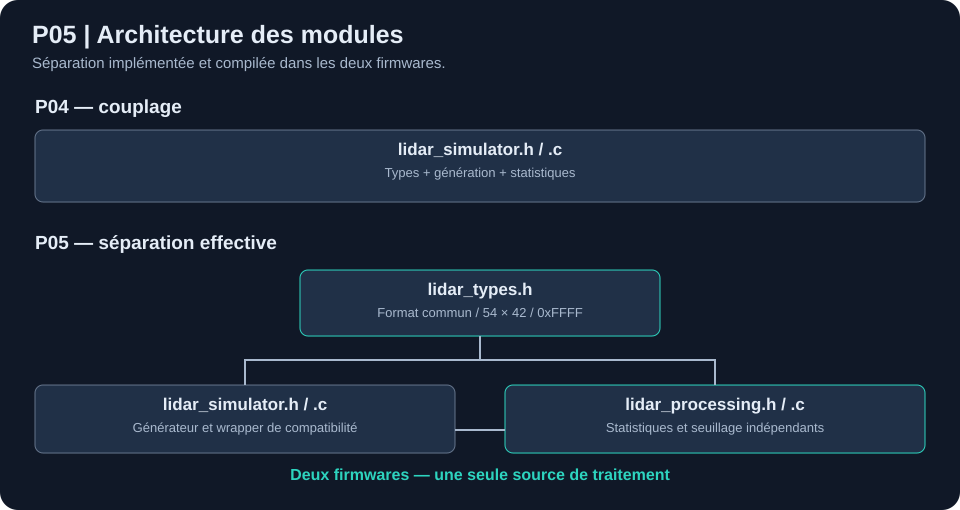
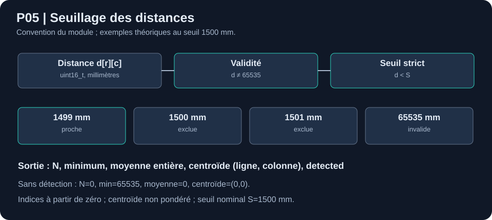
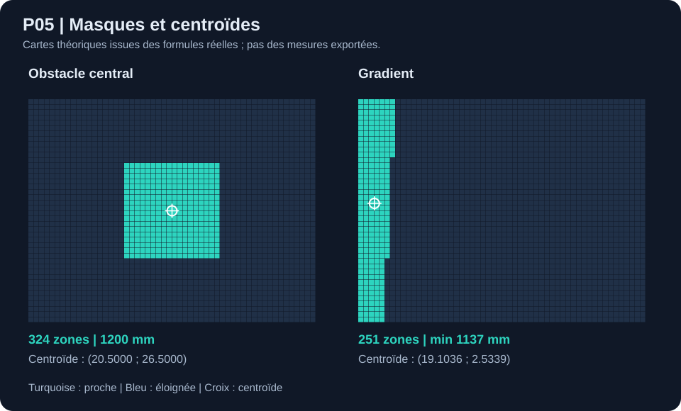
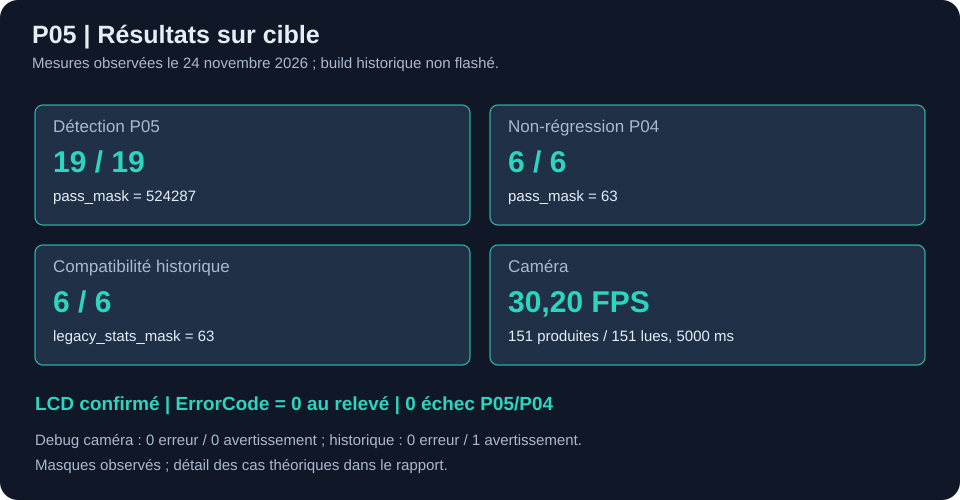

# P05 — Validation STM32 : traitements LiDAR indépendants

**Date :** 2026-11-24
**Branche :** `Note-de-Seb` — `rahim974/3Dscan2A`
**Baseline P04 :** `8cc3395930605d7e1495617f92d618ee4984723f`
**Statut :** validée STM32 dans le périmètre testé ; firmware historique compilé, non flashé.

## Architecture et compatibilité

Les constantes et les structures `LidarFrame`, `LidarFrameStats` et `LidarObstacleInfo` résident dans `lidar_types.h`. `lidar_processing.h/.c` ne dépendent ni du simulateur ni de HAL. Le corps des statistiques P04 est déplacé sans changement intentionnel ; `LidarSim_ComputeStats` délègue à `LidarProcessing_ComputeStats`. La génération des scènes est conservée. Le firmware caméra lie la source originale de traitement ; le firmware historique la compile via Core. Les chemins d'inclusion Debug/Release existants sont conservés. Seul Debug a été compilé dans cette passe.

## Conventions et références

54 colonnes, 42 lignes, 2268 zones, distances uint16_t en mm ; `0xFFFF` invalide. Zone proche si valide et strictement inférieure au seuil. Moyenne entière tronquée ; centroïde non pondéré, indices base zéro (ligne, colonne). Sans détection : count, mean, centroid et detected à zéro, nearest=65535. Distance 0 valide au sens du format. Pointeurs NULL : retour sans écriture (convention du code, non testée par les 19 cas STM32). Un résultat sans détection ne signifie pas que l'espace est libre. Pas de segmentation d'obstacles multiples.

Les six frames P04 sont générées avec seed 1234 réinitialisée ; mêmes références de statistiques, timestamp et empreintes que [P04](LIDAR_SIMULATION_VALIDATION_2026-11-24.md). Les essais de seuil réutilisent chaque frame ; cinq essais synthétiques précèdent le dernier cas P04 et réutilisent le même buffer. Zones synthétiques : (0,0)=0, (41,53)=1499, (0,53)=1500, (41,0)=1501, (1,1)=65534 ; toutes les autres invalides. Le centroïde est comparé avec une tolérance absolue de 0,0001 zone. Les chiffres du tableau sont les références théoriques du diagnostic ; le masque STM32 atteste la réussite des comparaisons, pas une retranscription individuelle des résultats bruts.

| Cas | Scène | Seuil mm | Proches | Min mm | Moy mm | Ligne | Colonne | STM32 |
|---:|---|---:|---:|---:|---:|---:|---:|---|
| 0 | Mur plat | 1500 | 0 | 65535 | 0 | 0.000000 | 0.000000 | PASS |
| 1 | Mur plat | 2000 | 0 | 65535 | 0 | 0.000000 | 0.000000 | PASS |
| 2 | Mur plat | 2001 | 2268 | 2000 | 2000 | 20.500000 | 26.500000 | PASS |
| 3 | Obstacle central | 1500 | 324 | 1200 | 1200 | 20.500000 | 26.500000 | PASS |
| 4 | Obstacle central | 1200 | 0 | 65535 | 0 | 0.000000 | 0.000000 | PASS |
| 5 | Obstacle central | 1201 | 324 | 1200 | 1200 | 20.500000 | 26.500000 | PASS |
| 6 | Gradient | 1500 | 251 | 1137 | 1333 | 19.103586 | 2.533865 | PASS |
| 7 | Bruit nominal | 1500 | 0 | 65535 | 0 | 0.000000 | 0.000000 | PASS |
| 8 | Bruit nominal | 2500 | 1066 | 2450 | 2474 | 20.275797 | 26.136961 | PASS |
| 9 | Sans bruit | 1500 | 0 | 65535 | 0 | 0.000000 | 0.000000 | PASS |
| 10 | Sans bruit | 2500 | 0 | 65535 | 0 | 0.000000 | 0.000000 | PASS |
| 11 | Sans bruit | 2501 | 2189 | 2500 | 2500 | 20.476016 | 26.367291 | PASS |
| 12 | Tout invalide | 1500 | 0 | 65535 | 0 | 0.000000 | 0.000000 | PASS |
| 13 | Tout invalide | 65535 | 0 | 65535 | 0 | 0.000000 | 0.000000 | PASS |
| 14 | Synthétique | 0 | 0 | 65535 | 0 | 0.000000 | 0.000000 | PASS |
| 15 | Synthétique | 1 | 1 | 0 | 0 | 0.000000 | 0.000000 | PASS |
| 16 | Synthétique | 1500 | 2 | 0 | 749 | 20.500000 | 26.500000 | PASS |
| 17 | Synthétique | 1501 | 3 | 0 | 999 | 13.666667 | 35.333333 | PASS |
| 18 | Synthétique | 65535 | 5 | 0 | 14006 | 16.600000 | 21.400000 | PASS |

## Compilation et mémoire

Windows 11, PowerShell, STM32CubeIDE, STM32CubeN6 v1.2.0, STM32N6570-DK, IMX335. Dépôt D:\Projet_2A, workspace D:\STM32_Workspace_Projet2A. Une carte utilisée, identifiant non relevé.

| Debug | Text (o) | Data (o) | BSS (o) | Total (o) | Erreurs | Avertissements |
|---|---:|---:|---:|---:|---:|---:|
| Caméra, 16:32:28 (incrémental) | 153980 | 324 | 793780 | 948084 | 0 | 0 |
| LiDAR historique, 16:33:34 | 15028 | 12 | 18500 | 33540 | 0 | 1 |

Avertissement historique : `main.c:110:21`, variable locale `test` inutilisée, conservée. ELF et BIN générés pour le firmware historique. Aucun flash historique effectué. Le map caméra daté de 16:23:51 montre `LidarProcessing_ComputeStats` à 0x341826A0 (284 o), `LidarProcessing_DetectObstacle` à 0x341827BC (322 o), `LidarSim_ComputeStats` à 0x34182FDA (26 o). Surcoût total face à P04 : 2296 o ; BSS +704 o.

| Élément | Début | Fin exclusive | Taille (o) |
|---|---|---|---:|
| `.bss.g_p04_frame` | 0x341C06A0 | 0x341C44A8 | 15880 |
| `.bss.g_p04` | 0x341C44B0 | 0x341C45F0 | 320 |
| `.bss.g_p05` | 0x341C45F0 | 0x341C48B0 | 704 |
| `.camera_snapshot` | 0x342E0000 | 0x3439B800 | 768000 |

LCD : 0x34200000, 768000 o (configuration P04 conservée). Le contrôle map de clôture vérifie les sections, leurs tailles et l'absence de recouvrement avec le LCD. Snapshot réservé ; aucun nouveau consommateur. `P03_SNAPSHOT_TEST_ENABLED=0`.

## Reproduction et résultats matériels

Compiler Debug caméra, lancer Debug, F8, laisser tourner au moins 10 s, suspendre et examiner `g_p05`, `g_p04`, `g_camera_fps`, `hdcmipp.ErrorCode`. Les essais P05 sont intégrés à la planification P04 (500 ms minimum entre générations) ; aucun second diagnostic périodique. Le diagnostic cesse après les cas et la fenêtre caméra de 5 s.

| Indicateur | Observé |
|---|---:|
| P05 completed / pass_mask / failures / done | 19 / 524287 / 0 / 1 |
| P05 legacy_stats_mask | 63 |
| P04 completed / pass_mask / failures / done | 6 / 63 / 0 / 1 |
| P04 width / height / frame_bytes | 54 / 42 / 15880 |
| P04 start_tick / last_tick | 1000 / 3512 ms |
| P04 start_frames / start_reads | 20 / 20 |
| P04 camera_elapsed_ms | 5000 |
| P04 camera_frames / camera_reads | 151 / 151 |
| Cadence calculée | 30,20 FPS |
| g_camera_fps au relevé antérieur | 31 |
| hdcmipp.ErrorCode au relevé antérieur | 0 |

LCD : flux caméra confirmé par l'opérateur. Cadence identique à P04 sur la fenêtre observée ; pas de perte déduite des compteurs différentiels. Les six comparaisons wrapper/API directe sont conformes ; elles ne constituent pas une seconde implémentation indépendante. Les références P04 constituent le contrôle indépendant de non-régression.

## Limites et clôture

Charge ponctuelle, une seule carte, pas de mesure de débit soutenu, pas de capteur physique, pas de validation Release, pas de flash du firmware historique, pas de retest d'intégrité snapshot. Les résultats détaillés par cas et leurs temps ne sont pas retranscrits séparément. Les cartes SVG sont des références théoriques, pas des exports de la STM32. P06 non implémentée.

Preuves : captures console CubeIDE, Expressions, PowerShell/map et confirmation LCD du chat P05 du 24/11/2026. Publication à contrôler après push ; le SHA du commit de clôture ne peut pas figurer dans son propre contenu.
