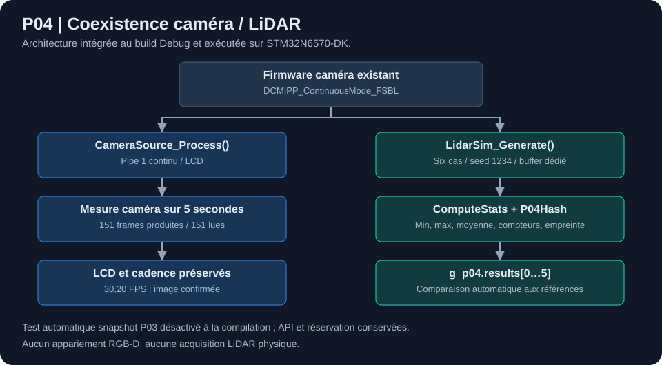
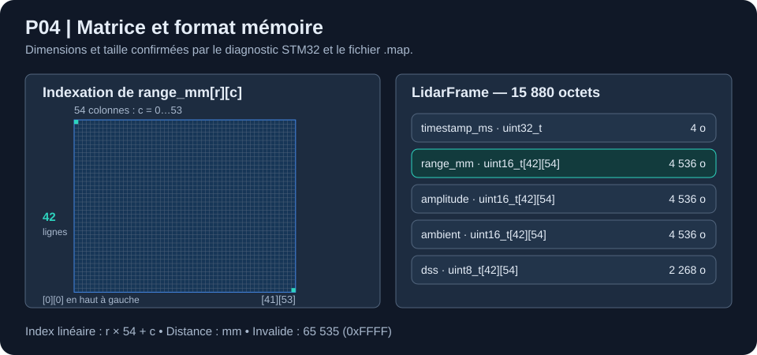
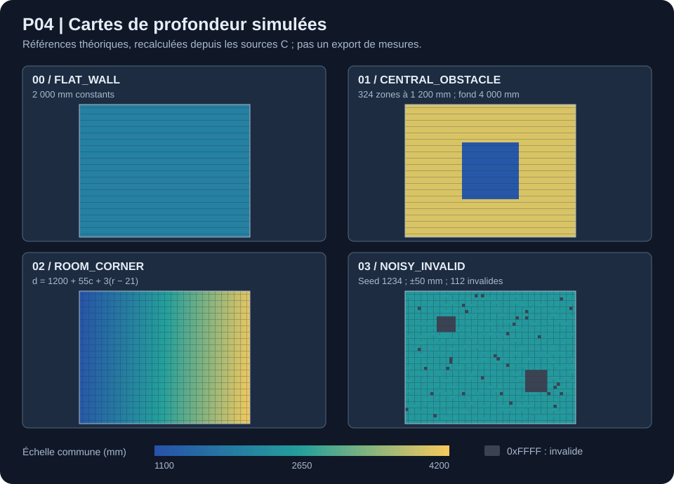
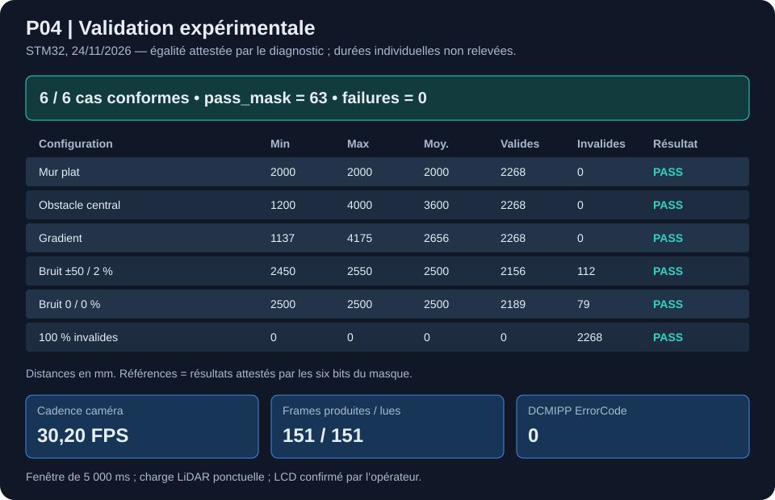

# P04 — Validation STM32 : LiDAR simulé et statistiques 54 × 42

**Date :** 2026-11-24
**Branche :** `Note-de-Seb` (`rahim974/3Dscan2A`)
**Baseline P03 :** `b1e0f50e58590a83695127733180bcb3713356bf`
**Statut :** validée STM32 dans le périmètre testé.

## Sources et intégration

- `firmware/lidar_sim/FSBL/Core/Inc/lidar_simulator.h` et `Core/Src/lidar_simulator.c` (source originale inchangée).
- `firmware/lidar_sim/FSBL/Core/Src/main.c` : les statistiques étaient déjà appelées, contrairement à l'indication historique du protocole HTML.
- `firmware/camera_imx335/FSBL/Src/main.c` : diagnostic P04 en boucle principale, six cas, 500 ms minimum entre les générations ; test snapshot automatique P03 isolé par `P03_SNAPSHOT_TEST_ENABLED=0`.
- Projet caméra `DCMIPP_ContinuousMode_FSBL` : ressource liée au simulateur original via `.project`, chemin d'inclusion ancré sur `ProjDirPath` dans `.cproject` (Debug et Release). Release non compilé dans cette validation.

## Format et conventions

54 colonnes, 42 lignes, 2268 zones ; indexation `[r][c]`, index linéaire `r*54+c` ; distances en millimètres ; invalide `0xFFFF`. Frame de 15880 octets : timestamp 4, trois matrices uint16_t de 4536 octets chacune et DSS uint8_t de 2268 octets. Amplitude, ambient et DSS sont synthétiques ; pas de calibration physique. La moyenne entière exclut les invalides. Si aucune zone n'est valide, min, max et moyenne valent 0.

## Références indépendantes

- FLAT_WALL : 2000 mm partout.
- CENTRAL_OBSTACLE : lignes 12–29 et colonnes 18–35 incluses, soit 324 zones à 1200 mm ; 1944 zones à 4000 mm.
- ROOM_CORNER : `1200 + 55*c + 3*(r-21)` ; bornes de saturation 500–5000 mm non atteintes dans cette scène. C'est un gradient affine, non une géométrie complète de coin.
- NOISY_INVALID : 2500 mm + bruit signé ; deux rectangles forcés invalides (r=8..12, c=10..15 ; r=25..31, c=38..44) soit 79 zones, en plus du tirage pseudo-aléatoire. Le pourcentage configuré ne représente pas le taux total.

Chaque cas réinitialise Xorshift32 avec seed 1234. L'empreinte est une variante de FNV sur les valeurs entières (pas sur les octets) : initialisation 2166136261, pour chaque zone en ordre ligne-colonne, XOR puis multiplication modulo 2^32 par 16777619 pour range, amplitude, ambient et dss, dans cet ordre. Les six références ont été reproduites indépendamment en JS puis Python depuis les sources auditées.

## Compilation et mémoire

Windows 11, PowerShell, STM32CubeIDE, STM32CubeN6 v1.2.0, STM32N6570-DK + IMX335. Dépôt `D:\Projet_2A`, workspace `D:\STM32_Workspace_Projet2A`. Une carte utilisée ; identifiant individuel non relevé.

Premier build : 5 erreurs, 0 avertissement, header non résolu ; source C correctement liée. P04-A : correction de l'include. Build incrémental final à 16:07:10 : 0 erreur, 0 avertissement, 194 ms (dernière invocation incrémentale, pas durée d'une compilation complète). Text 152388, data 324, BSS 793076, total 945788 octets. ELF et map datés 16:07:07.

| Élément | Début | Fin exclusive | Taille |
|---|---|---|---:|
| Frame LiDAR (`.bss.g_p04_frame`, map) | 0x341C06A0 | 0x341C44A8 | 15880 |
| LCD (baseline P03, configuration conservée) | 0x34200000 | 0x342BB800 | 768000 |
| Snapshot (`.camera_snapshot`, map) | 0x342E0000 | 0x3439B800 | 768000 |
| Diagnostic (`.bss.g_p04`, map) | 0x341C44B0 | 0x341C45F0 | 320 |

Frame et diagnostic dans la RAM applicative ; pas de chevauchement. `LidarSim_Generate`, `LidarSim_ComputeStats`, `P04Hash` et `P04TestProcess` présents dans le map. Réservation snapshot inchangée ; aucun nouveau consommateur snapshot.

## Reproduction et résultats STM32

1. Compiler Debug, vérifier le map (adresses et tailles ci-dessus pour ce build).
2. Lancer Debug puis F8 ; laisser la caméra tourner au moins 10 s ; vérifier l'image LCD.
3. Suspendre et inspecter `g_p04`, `g_camera_fps`, `hdcmipp.ErrorCode` ; les résultats sont conservés dans `g_p04.results[0..5]`.
4. Le diagnostic vérifie dimensions, taille, timestamp, min/max/moyenne, compteurs, somme des compteurs et empreinte des quatre matrices. Un bit par cas dans `pass_mask`.

| Cas | Bruit (mm) | Invalides configurés (%) | Min (mm) | Max (mm) | Moy. (mm) | Valides | Invalides | Empreinte | Résultat |
|---|---:|---:|---:|---:|---:|---:|---:|---:|---|
| 0 Mur plat | 50 | 2 | 2000 | 2000 | 2000 | 2268 | 0 | 3250742445 | PASS |
| 1 Obstacle central | 50 | 2 | 1200 | 4000 | 3600 | 2268 | 0 | 1354660117 | PASS |
| 2 Gradient | 50 | 2 | 1137 | 4175 | 2656 | 2268 | 0 | 2634872127 | PASS |
| 3 Bruit nominal | 50 | 2 | 2450 | 2550 | 2500 | 2156 | 112 | 3424744673 | PASS |
| 4 Sans bruit | 0 | 0 | 2500 | 2500 | 2500 | 2189 | 79 | 1515758359 | PASS |
| 5 Tout invalide | 50 | 100 | 0 | 0 | 0 | 0 | 2268 | 3875788133 | PASS |

Les colonnes numériques sont les références ; leur égalité avec les résultats STM32 est attestée par les six bits du masque. Les champs individuels étaient repliés dans les captures ; les durées individuelles et les valeurs brutes ne sont pas retranscrites indépendamment. Les cartes SVG sont théoriques, non des exports STM32. L'empreinte est un contrôle de cohérence, non une preuve mathématique d'égalité exhaustive sans collision.

| Indicateur observé dans le débogueur | Valeur |
|---|---:|
| completed / pass_mask / failures / done | 6 / 63 / 0 / 1 |
| width / height / frame_bytes | 54 / 42 / 15880 |
| start_tick / last_tick (ms) | 1000 / 3507 |
| start_frames / start_reads | 20 / 20 |
| camera_elapsed_ms | 5000 |
| camera_frames / camera_reads | 151 / 151 |
| Cadence calculée | 30,20 FPS |
| g_camera_fps au relevé | 30 |
| hdcmipp.ErrorCode au relevé | 0 |

LCD : image réelle de la caméra confirmée par l'opérateur. Pas d'écart entre les compteurs sur la fenêtre observée. Cadences historiques : P01 30,26 FPS, P02 30,45 FPS, P03 30,20 FPS ; méthodes et fenêtres non strictement identiques.

## Conclusion et limites

P04 validée STM32 pour les quatre scènes, les six configurations et la coexistence caméra/LCD. Charge LiDAR ponctuelle (six essais dans une fenêtre de 5 s), non un flux à fréquence maximale ; une seule carte et session courte. Le snapshot automatique est désactivé, donc son intégrité n'est pas retestée en coexistence. Pas de mesure des durées par cas, de test longue durée ou du capteur physique. Le diagnostic P04 s'arrête après six cas et reste disponible en mémoire ; à isoler explicitement lors d'une intégration ultérieure si nécessaire. Aucun travail P05 réalisé.

Preuves : captures PowerShell, console Debug, fichier map et Expressions du chat P04 du 24/11/2026 ; confirmation visuelle LCD de l'opérateur. Publication et vérification de la branche par le script de clôture ; le SHA de ce commit ne peut être inscrit dans son propre contenu.
