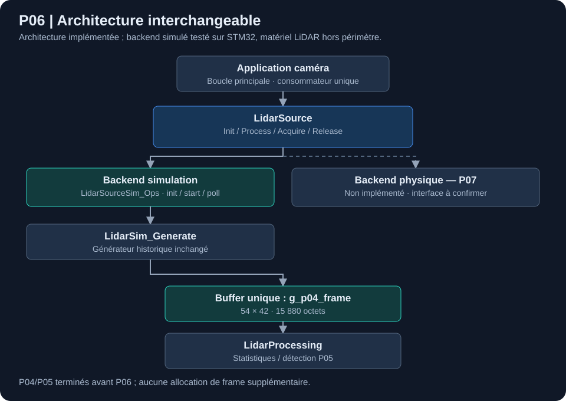
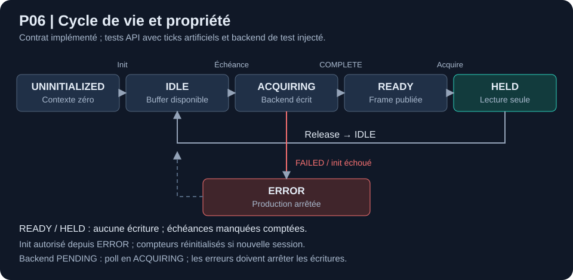
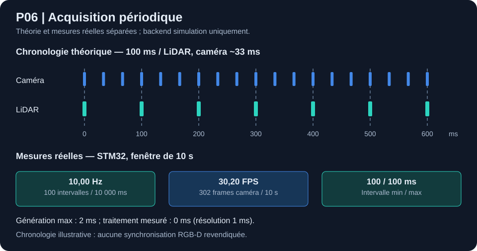
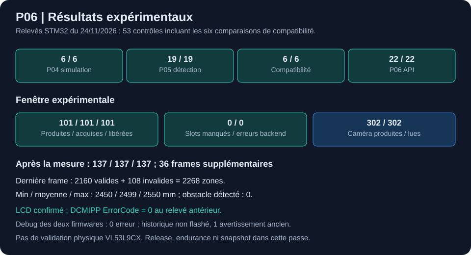

# P06 — Validation STM32 : LidarSource interchangeable

**Date :** 2026-11-24
**Dépôt / branche :** `rahim974/3Dscan2A` / `Note-de-Seb`
**Baseline P05 :** `b45ea57a3a5623b618dd0c337f42954bbcfb6ee4`
**Statut :** validée STM32 dans le périmètre testé ; backend simulé uniquement.

## Architecture et contrat

Les modules `lidar_source.h/.c` sont indépendants de HAL et du simulateur. `LidarBackendOps` expose `init`, `start`, `poll` ; `LidarSourceSim_Ops` réutilise le générateur historique sans duplication. Les sources sont compilées dans Core pour le firmware historique et liées au projet caméra. Les traitements P05 et `lidar_types.h` restent inchangés. Le `main.c` historique conserve son comportement ; ses nouveaux objets sont compilés mais les fonctions inutilisées peuvent être éliminées par le linker.

| API | Contrat |
|---|---|
| Init | Contexte initialement zéro ; état UNINITIALIZED ou ERROR ; période 1 à 0x7FFFFFFF ms ; backend et buffer fournis par l'appelant et valides pendant la vie de la source |
| Process | OK uniquement lors d'une nouvelle publication ; NOT_READY si pas de publication ; tick monotone modulo 2^32, moins d'un tour entre appels |
| IsFrameReady | Vrai uniquement en READY |
| AcquireFrame | READY → HELD ; pointeur const, ID de publication et timestamp ; sortie inchangée en cas d'échec |
| ReleaseFrame | HELD → IDLE ; ne plus utiliser le pointeur après libération |
| GetState / GetCounters | Lecture d'état et copie des compteurs |

Consommateur unique en boucle principale ; pas d'appel en ISR, pas d'allocation dynamique. Le backend emprunte le buffer pendant start/poll ; COMPLETE publie les matrices et le timestamp, FAILED impose l'arrêt des écritures. Le backend physique devra traiter lui-même les délais d'attente, DMA/cache et arrêt des écritures. Aucun pilote physique n'est implémenté. Init réussi après ERROR remet les compteurs à zéro. Les ID et compteurs uint32_t évoluent modulo 2^32, ID initial 1. L'identifiant reste hors de LidarFrame (15880 o). Timestamp simulé = tick de déclenchement logiciel, pas fin d'exposition physique. READY et HELD ne peuvent pas être écrasés ; échéances manquées comptées sans rafale de rattrapage. Le diagnostic P04/P05 s'arrête avant les tests P06, puis le flux utilise le même `g_p04_frame`. P03_SNAPSHOT_TEST_ENABLED=0 ; aucun consommateur snapshot ajouté.

## Tests API embarqués

Les 22 bits ci-dessous sont les assertions réellement codées par P06TestAPI ; les ticks de ces tests sont artificiels. Les chemins asynchrones et erreurs utilisent un backend de test injecté, non un capteur physique.

| Bit | Contrôle | STM32 |
|---:|---|---|
| 0 | Source non initialisée : état et appels refusés | PASS |
| 1 | Arguments invalides (période zéro, buffer NULL, source NULL) | PASS |
| 2 | Initialisation près du wrap du tick | PASS |
| 3 | Avant échéance, après wrap : NOT_READY | PASS |
| 4 | Échéance après wrap : READY, timestamp et hash central | PASS |
| 5 | Acquire avec sortie NULL : refus, READY conservé | PASS |
| 6 | READY non consommée : hash et timestamp conservés | PASS |
| 7 | Acquire : pointeur, ID 1, timestamp et HELD | PASS |
| 8 | Double Acquire et réinitialisation HELD refusées, vue conservée | PASS |
| 9 | HELD : hash et timestamp stables, 3 slots manqués | PASS |
| 10 | Release puis double Release refusée | PASS |
| 11 | Reprise à échéance suivante, ID 2 | PASS |
| 12 | Retard de trois périodes : une seule frame, ID 3, pas de rafale | PASS |
| 13 | Compteurs 3/3/3, 5 slots manqués, 0 erreur | PASS |
| 14 | Configuration simulation invalide : ERROR | PASS |
| 15 | Réinitialisation après ERROR via backend de test | PASS |
| 16 | Backend PENDING : ACQUIRING, Acquire refusé | PASS |
| 17 | Poll PENDING et slot manqué compté | PASS |
| 18 | Poll COMPLETE : ID 1 et timestamp de départ | PASS |
| 19 | Échec start : ERROR et compteur | PASS |
| 20 | Échec poll : aucune publication, ERROR | PASS |
| 21 | Échec init : ERROR | PASS |

Observé : api_completed=22, api_pass_mask=4194303, api_failures=0. Les contrôles d'intégrité par empreinte ne constituent pas une preuve exhaustive sans collision. Le test GCC natif préalable utilisait des doublures logicielles ; il ne constitue pas une mesure matérielle.

## Cadence et coexistence

Configuration : NOISY_INVALID, graine 1234 à l'initialisation, bruit ±50 mm, invalides configurés 2 % (rectangles forcés en plus), seuil obstacle strict 1500 mm. PRNG non réinitialisé entre frames. Période 100 ms, sans HAL_Delay. Fenêtre de mesure : 101 frames et 100 intervalles. Les statistiques et la détection sont calculées sur chaque frame avant libération. Les compteurs g_p06 sont figés après la fenêtre, l'acquisition se poursuit.

| Mesure STM32 | Observé |
|---|---:|
| started / done / runtime_fault / measurement_pass | 1 / 1 / 0 / 1 |
| samples / interval_count | 101 / 100 |
| interval_min_ms / interval_max_ms | 100 / 100 |
| premier / dernier timestamp (ms) | 6101 / 16101 |
| elapsed_ms | 10000 |
| premier / dernier ID | 1 / 101 |
| id_failures / timestamp_failures / data_failures | 0 / 0 / 0 |
| hash_first / hash_second | 3424744673 / 4087108911 |
| max_generate_ms / max_processing_ms | 2 / 0 |
| produced / acquired / released | 101 / 101 / 101 |
| missed_slots / backend_errors | 0 / 0 |
| camera_start_ms | 6103 |
| start_camera_frames / start_camera_reads | 174 / 174 |
| camera_frames / camera_reads | 302 / 302 |
| camera_elapsed_ms | 10000 |
| LiDAR (100 intervalles / 10 s) | 10,00 Hz |
| Caméra (302 frames / 10 s) | 30,20 FPS |
| g_camera_fps au relevé antérieur | 31 |
| hdcmipp.ErrorCode au relevé antérieur | 0 |

Les deux empreintes correspondent aux références recalculées avant test (112 et 113 invalides attendus respectivement, contrôlés par data_failures). La mesure 0 ms du traitement signifie aucune durée non nulle observée avec la résolution milliseconde ; elle ne prouve pas un temps nul. Les intervalles sont égaux à 100 ms à cette résolution. La fenêtre caméra est décalée de 2 ms au départ par rapport aux timestamps LiDAR ; aucune synchronisation RGB-D revendiquée.

Après diagnostic : produced=acquired=released=137, missed_slots=backend_errors=0 ; 36 publications supplémentaires observées. Dernières statistiques : min=2450, max=2550, mean=2499 mm, 2160 valides et 108 invalides (2268 au total). Obstacle : close_count=0, nearest_mm=65535, mean_close_mm=0, centroid_row=centroid_col=0, detected=0. Absence de détection au seuil testé, pas une garantie d'espace libre. LCD : flux réel caméra confirmé explicitement par l'opérateur.

## Non-régression

| Diagnostic | completed | pass_mask | failures | done |
|---|---:|---:|---:|---:|
| P04 | 6 | 63 | 0 | 1 |
| P05 | 19 | 524287 | 0 | 1 |
| P06 API | 22 | 4194303 | 0 | 1 (diagnostic global) |

P05 legacy_stats_mask=63 : six comparaisons supplémentaires (wrapper et API directe, non indépendantes). Total : 53 contrôles réussis en comptant ces comparaisons, pas 53 tests indépendants. P04 : width=54, height=42, frame_bytes=15880, start_tick=1000, last_tick=3512, start_frames=start_reads=21, camera_frames=camera_reads=150 en 5000 ms (30,00 FPS). Aucune perte déduite des compteurs différentiels. Les rapports P04/P05 restent les références des données individuelles.

## Compilation et mémoire

Windows 11, PowerShell, STM32CubeIDE, STM32CubeN6 v1.2.0, STM32N6570-DK + IMX335. Dépôt D:/Projet_2A, workspace D:/STM32_Workspace_Projet2A ; une carte, identifiant individuel non relevé.

| Debug | Heure | Text (o) | Data (o) | BSS (o) | Total (o) | Erreurs | Avertissements |
|---|---|---:|---:|---:|---:|---:|---:|
| Caméra | 16:52:21 | 158900 | 344 | 793992 | 953236 | 0 | 0 |
| Historique | 16:52:46 | 15028 | 12 | 18500 | 33540 | 0 | 1 |

Durées affichées 1,357 s et 1,069 s ; builds incrémentaux. Avertissement historique : main.c:110, variable test inutilisée. ELF/BIN/MAP présents. Les deux nouveaux objets sont dans les deux objects.list ; symboles Init, Process, AcquireFrame, ReleaseFrame, LidarSourceSim_Ops et P06Process dans le MAP caméra. Historique non flashé. Surcoût caméra vs P05 : Text +4920, Data +20, BSS +212, total +5152 o.

| Région | Début | Fin exclusive | Taille (o) |
|---|---|---|---:|
| .bss.g_p04_frame | 0x341C06B0 | 0x341C44B8 | 15880 |
| .bss.g_p06_source | 0x341C48C0 | 0x341C48EC | 44 |
| .bss.g_p06 | 0x341C4910 | 0x341C4998 | 136 |
| LCD (configuration conservée) | 0x34200000 | 0x342BB800 | 768000 |
| .camera_snapshot | 0x342E0000 | 0x3439B800 | 768000 |

Contrôle MAP P06-C réussi ; régions disjointes, réservation snapshot conservée. Les deux language.settings.xml ont été contrôlés : seules les valeurs env-hash locales sont modifiées ; hors commit.

## Reproduction, preuves et limites

1. Compiler Debug des deux projets après Refresh, vérifier le MAP et les objets.
2. Lancer uniquement DCMIPP_ContinuousMode_FSBL. La première session d'expressions était en erreur ; relance sur le bon projet réussie. F8, laisser tourner au moins 25 s, suspendre et relever g_p06, g_p06_source.counters, g_p06_live_stats, g_p06_live_obstacle, g_p04, g_p05, g_camera_fps, hdcmipp.ErrorCode ; confirmer LCD. Captures du chat du 24/11/2026 : terminal P06-B/P06-C, consoles CubeIDE, Expressions et confirmation opérateur.
3. Les mesures ci-dessus proviennent des relevés visibles ; schémas d'architecture et chronologie théoriques explicitement distingués des mesures.

Limites : capteur physique absent des essais, backend asynchrone testé uniquement par doublure, aucune mesure d'endurance longue, résolution temporelle 1 ms, une seule carte, pas de Release compilé, historique non flashé, intégrité snapshot non retestée, pas de synchronisation RGB-D ni de reconstruction. Aucun résultat de débit maximal revendiqué. P07 non commencée. Publication à vérifier après push ; le SHA du commit de clôture ne peut figurer dans son propre contenu.
